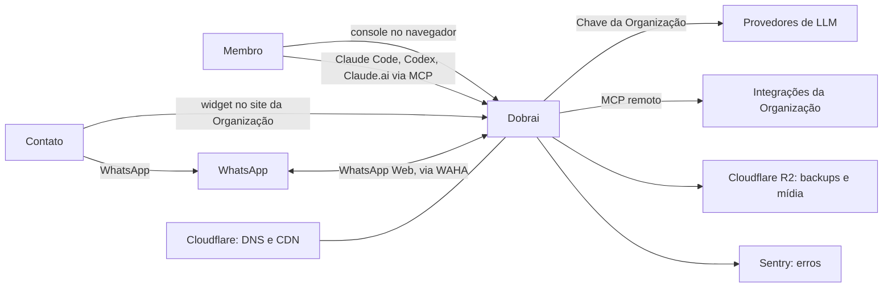
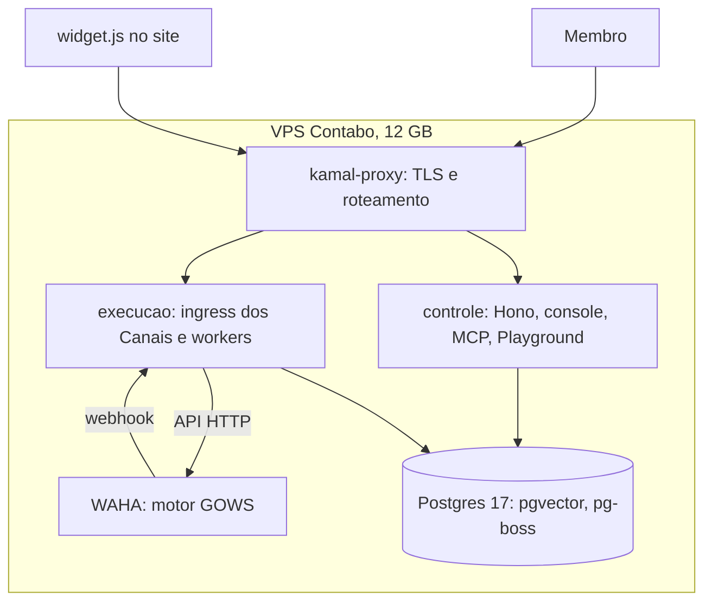

# 01 — Arquitetura

O Dobrai tem dois planos. O **plano de controle** atende Membros: console, Construtor, MCP, configuração. O **plano de execução** atende Contatos: recebe mensagens dos Canais, executa o turno do Agente e responde. Os dois são artefatos separados do mesmo monólito modular ([ADR-0001](adr/0001-monolito-modular-com-tres-artefatos.md)) e dividem um Postgres num único VPS.

## Contexto

## Containers

| | Plano de controle (`controle`) | Plano de execução (`execucao`) |
|---|---|---|
| Quem usa | Membros | Contatos (widget) e WAHA |
| Endereço | `app.dobrai.ai` | `chat.dobrai.ai` |
| O que roda | rotas de todos os slices para o console, `/mcp`, Construtor web, Playground | `widget.js`, ingress do widget e do WAHA, SSE do widget, workers da fila |
| Se cair | ninguém edita nada; Agentes continuam atendendo | Contatos ficam sem resposta; mensagens do WAHA esperam o webhook voltar |
| Deploy | independente | independente |

Montagem de cada artefato, pastas e pipeline: [05](05-slices-e-deploy.md).

## Uma mensagem de ponta a ponta

O desenho detalhado, com idempotência, agrupamento e streaming, está em [04](04-canais.md). Os tempos esperados em cada etapa:

| Etapa | Onde | Tempo |
|---|---|---|
| Webhook do WAHA ou POST do widget → gravar mensagem e job | `execucao` | < 50 ms |
| Janela de agrupamento | fila | 3 s no WhatsApp, 0 no widget |
| Busca no Brain (embedding local da pergunta + consulta híbrida) | `execucao` | < 100 ms [I] |
| Chamada ao modelo, com ferramentas quando houver | provedor | 1–5 s, primeiro token em ~1 s [I] |
| Envio pelo WAHA, ou último delta no SSE | `execucao` | < 500 ms [I] |

[I] marca estimativa a medir na F1.7 e na F2.2.

## Memória no VPS de 12 GB

Supondo um número de WhatsApp por Organização:

| Componente | 10 Orgs | 50 Orgs | 100 Orgs |
|---|---|---|---|
| Postgres (`shared_buffers` de 1 GB + ~60 conexões) [I] | 2,0 GB | 2,0 GB | 2,0 GB |
| `controle` (Bun) [I] | 0,4 GB | 0,4 GB | 0,4 GB |
| `execucao` (Bun) + multilingual-e5-small [I] | 0,9 GB | 0,9 GB | 0,9 GB |
| WAHA GOWS ([tabela oficial](https://waha.devlike.pro/docs/overview/faq/)) | 1,0 GB | 3,0 GB | 5,0 GB |
| kamal-proxy e sistema operacional [I] | 0,6 GB | 0,6 GB | 0,6 GB |
| **Total** | **4,9 GB (41%)** | **6,9 GB (58%)** | **8,9 GB (74%)** |

Perto de 100 números o uso chega aos 75%, que é o gatilho do primeiro degrau. Na CPU, a mesma tabela do WAHA pede 0,5 vCPU para 10 sessões, 1,5 para 50 e 3 a 5 para 100, dos 6 vCPUs do VPS. A RAM real por número é medida no staging ([07](07-riscos.md)).

## Custo mensal de infraestrutura

| Item | 10 Orgs | 50 Orgs | 500 Orgs |
|---|---|---|---|
| VPS principal | VPS 6 (12 GB): US$ 12,00 | VPS 6 (12 GB): US$ 12,00 | VPS 8 (24 GB), só Postgres, controle e execução: US$ 22,70 |
| VPS do WAHA | — | — | 2 × VPS 8 (~250 números cada; 500 sessões pedem 25 GB): US$ 45,40 |
| Cloudflare R2 ([preços](https://developers.cloudflare.com/r2/pricing/), 28/09/2026: 10 GB-mês grátis, egress grátis) | 0 | 0 | backups e mídia acima de 10 GB, cobrados por GB |
| Cloudflare DNS e CDN, Sentry, GitHub Actions | 0 (planos gratuitos) [I] | 0 [I] | 0 [I] |
| **Total** | **US$ 12,00** | **US$ 12,00** | **~US$ 68 + excedente do R2** |

O domínio é custo anual à parte, fora da conta.

Preços da Contabo com contrato mensal, na costa leste dos EUA, sem taxa de instalação ([VPS 6](https://contabo.com/en-us/vps/cloud-vps-core-6/), [VPS 8](https://contabo.com/en-us/vps/cloud-vps-core-8/), 28/09/2026). O VPS 6 custa US$ 9,00 mais US$ 3,00 da localização; o VPS 8, US$ 16,80 mais US$ 5,90. O contrato de 12 meses baixa o VPS 6 para US$ 10,65. Imposto sobre venda no checkout não foi confirmado. Com 10 e 50 Organizações o gasto fica muito abaixo do teto de US$ 50. Com 500, passa do teto (~US$ 68), mas nessa altura a receita já cobre a diferença.

### Gatilhos de cada degrau

| Degrau | Gatilho (métrica) | O que muda |
|---|---|---|
| 1 | RAM acima de 75% por 7 dias, ou mais de 100 números conectados | WAHA vai para um segundo VPS |
| 2 | CPU do Postgres acima de 70% em horário comercial, ou p95 do turno (sem o modelo) acima de 500 ms | Postgres vai para um VPS próprio |
| 3 | Cada ~250 números novos | mais um VPS de WAHA |
| 4 | Receita que pague a diferença | Postgres gerenciado com réplica, fim do ponto único de falha |

## Custo de LLM por Conversa típica

**Conversa típica:** 8 mensagens do Contato, prompt fixo (regras + Versão do Agente) de 3.000 tokens, 1.500 tokens do Brain por turno, 120 tokens de resposta por turno e uma chamada de ferramenta a cada dois turnos. Isso dá 12 chamadas ao modelo, ~136 mil tokens de entrada e ~1.200 de saída. Quem paga é a Organização, na própria chave.

| Modelo sugerido | Sem cache | Com cache |
|---|---|---|
| `gpt-6-luna` (OpenAI, raciocínio desligado) | US$ 0,014 | **US$ 0,004** |
| `gemini-3.1-flash-lite` (Google) | US$ 0,036 | **US$ 0,009** |
| `claude-sonnet-5-5` (Anthropic) | US$ 0,284 | **US$ 0,080** |

O cache reduz de 72% a 82%, por isso a ordem fixa dos blocos do prompt ([03](03-agent-spec.md)). Guardar os trechos do Brain no histórico dobra a entrada; tirar esses trechos corta metade dos tokens mas também derruba o aproveitamento do cache. A escolha é medida na F2.4.

**Sessão do Construtor** [I]: cerca de 15 mensagens do Membro e 30 chamadas, com prompt e ferramentas de ~6 mil tokens e histórico crescendo até ~30 mil. Fica em torno de US$ 0,35 com `claude-sonnet-5-5` e cache, e de US$ 0,70 com `claude-opus-5-5`. É volume baixo, então o Construtor pode usar o melhor modelo da Conexão.

### Modelos que o console sugere

| Provedor | Agente | Construtor |
|---|---|---|
| OpenAI | `gpt-6-luna` | `gpt-6-sol` |
| Anthropic | `claude-sonnet-5-5` | `claude-opus-5-5` |
| Google | `gemini-3.1-flash-lite` | `gemini-3.8-flash` |
| OpenRouter / compatível | escolha livre entre modelos com ferramentas | idem |

O Haiku 4.5 fica fora das sugestões porque a Anthropic só garante o modelo até 15/10/2026. O DeepSeek (`deepseek-flash`, o mais barato: ~US$ 0,004 por Conversa) aparece só com aviso de transferência de dados para a China ([07](07-riscos.md), L2).

### Preços pesquisados (28/09/2026)

| Modelo | Entrada / M | Cache leitura / M | Saída / M | Fonte |
|---|---|---|---|---|
| `gpt-6-luna` | 0,10 | 0,01 | 0,50 | [OpenAI](https://developers.openai.com/api/docs/pricing) |
| `gpt-6-sol` | 2,00 | 0,20 | 10,00 | idem |
| `claude-sonnet-5-5` | 2,00 | 0,20 | 10,00 | [Anthropic](https://platform.claude.com/docs/en/about-claude/pricing) |
| `claude-opus-5-5` | 4,00 | 0,20 | 20,00 | idem |
| `gemini-3.1-flash-lite` | 0,25 | 0,025 | 1,50 | [Google](https://ai.google.dev/gemini-api/docs/pricing) (atualizada em 24/09/2026) |
| `gemini-3.8-flash` | 0,75 (1,50 a partir de 01/01/2027) | 0,075 | 3,75 (7,50 em 2027) | idem |
| `deepseek-flash` | 0,15 fora de pico | 0,003 | 0,60 | [DeepSeek](https://api-docs.deepseek.com/quick_start/pricing) |

Esses valores alimentam a tabela `llm.preco_modelo`.

## O que vem do Craft como referência

| Padrão | Arquivo no Craft (`v0.13.6`) | Onde usamos |
|---|---|---|
| Definição única de ferramenta (nome, Zod, handler) | `packages/session-tools-core/src/tool-defs.ts` | ferramentas do Construtor ([03](03-agent-spec.md)) |
| Eventos de streaming do agente | `packages/core/src/types/message.ts` (`AgentEvent`) | SSE do widget e do Playground ([04](04-canais.md)) |
| Saneamento de dados injetados no prompt | `packages/shared/src/prompts/prompt-sanitize.ts` | bloco `<dados>` ([03](03-agent-spec.md)) |
| Pool de clientes MCP e nome `mcp__{fonte}__{ferramenta}` | `packages/shared/src/mcp/mcp-pool.ts`, `proxy-tool-name.ts` | Integrações |
| OAuth para MCP remoto (descoberta, PKCE, registro dinâmico) | `packages/shared/src/auth/oauth.ts` | Integrações com OAuth, depois do MVP |
| i18n com registro de locales e checagem de paridade no CI | `packages/shared/src/i18n/registry.ts`, `scripts/check-i18n-parity.ts` | `packages/i18n` |

O Craft não trata conteúdo não confiável em resultados de ferramenta nem em mensagens de canal. Essa parte o Dobrai desenha do zero.
