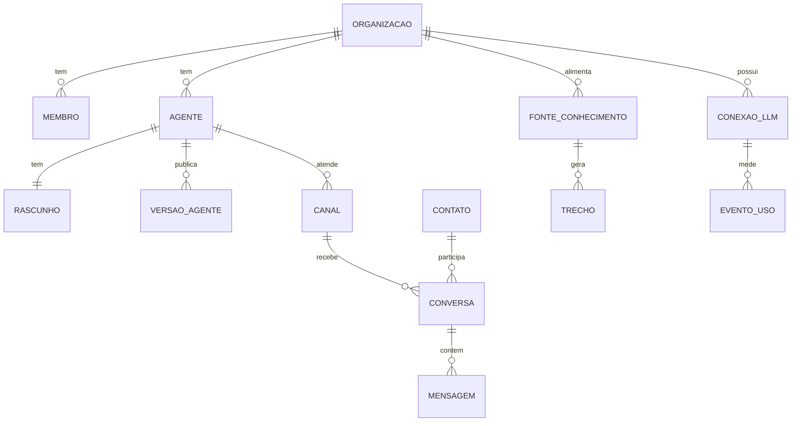

# 02 — Modelo de dados

Um Postgres, um schema por slice, tabelas compartilhadas entre Organizações com `org_id` e RLS ([ADR-0005](adr/0005-isolamento-com-rls.md)). Este documento cobre só as entidades do MVP vendável (F1 + F2). Termos em [CONTEXT.md](../CONTEXT.md).

## Regras gerais

- **Dono único.** Cada tabela pertence a um slice. Outro slice só a alcança pela API de módulo ou por eventos; em SQL, só pelo `id` guardado como referência sem chave estrangeira entre schemas.
- **Um papel de banco por slice** ([ADR-0009](adr/0009-papel-de-banco-por-slice.md)). Cada slice conecta com o papel `app_<slice>`, que tem `USAGE` só no próprio schema e nenhum `BYPASSRLS`. A fronteira "nenhum slice lê tabela de outro" fica garantida pelo Postgres, não por disciplina.
- **`org_id` em toda tabela de dados de Organização**, `not null`, primeiro campo de todo índice composto.
- **Contexto de Organização por transação.** Toda transação de aplicação começa com `set local app.org_id = '<uuid>'`. Workers leem o `org_id` do payload do job e fazem o mesmo.
- **Falha alta.** As políticas usam `app.org_atual()`, que lança erro quando o contexto não foi definido. Query sem Organização é bug, e bug aparece.
- **Identificadores** são UUIDv7 (ordenáveis por tempo). Datas em `timestamptz`.

### Política padrão

```sql
create function app.org_atual() returns uuid language plpgsql stable as $$
declare v text := current_setting('app.org_id', true);
begin
  if v is null or v = '' then
    raise exception 'app.org_id não definido';
  end if;
  return v::uuid;
end $$;

alter table agentes.agente enable row level security;
alter table agentes.agente force row level security;
create policy isolamento on agentes.agente
  using (org_id = app.org_atual())
  with check (org_id = app.org_atual());
```

### Tabelas sem RLS (e por quê)

| Tabela | Motivo | O que contém |
|---|---|---|
| `identidade.*` (Better Auth) | é lida antes de existir contexto de Organização (login, convite) | Usuários, sessões, Organizações, Membros; só o papel `app_identidade` acessa |
| `canais.roteamento` | webhook do WAHA e widget chegam sem Organização; é daqui que ela sai | `chave_publica` → `canal_id`, `org_id`; nenhum dado pessoal |
| `llm.preco_modelo` | tabela de referência global | preço por milhão de tokens por modelo |

Jobs que antes varreriam todas as Organizações (fechar Conversa inativa, reindexar Fonte) viram jobs agendados por entidade, com o `org_id` no payload. Assim nenhum papel de aplicação precisa de `BYPASSRLS`.

## Entidades por slice



As setas entre slices diferentes são referências por `id`, sem chave estrangeira.

### `identidade`

Tabelas gerenciadas pelo Better Auth (plugins `organization` e `mcp`): `user`, `session`, `account`, `verification`, `organization`, `member`, `invitation` e as tabelas de cliente e token OAuth do MCP. O slice não cria tabelas próprias no MVP.

| Papel (glossário) | Papel no Better Auth |
|---|---|
| Dono | `owner` |
| Admin | `admin` |
| Operador | `operador` (papel customizado) |

### `agentes`

| Tabela | Colunas principais | Observações |
|---|---|---|
| `agente` | `id`, `org_id`, `nome`, `versao_publicada_id` (nula até Publicar), `criado_em`, `arquivado_em` | |
| `rascunho` | `agente_id` (PK), `org_id`, `spec jsonb`, `spec_versao_schema`, `base_versao_id`, `atualizado_em`, `atualizado_por` | um por Agente; válido contra a forma parcial do schema ([03](03-agent-spec.md)) |
| `versao_agente` | `id`, `org_id`, `agente_id`, `numero`, `spec jsonb`, `spec_versao_schema`, `publicada_em`, `publicada_por`, `nota` | imutável; `unique (agente_id, numero)` |
| `alteracao_rascunho` | `id`, `org_id`, `agente_id`, `membro_id`, `origem` (`console` \| `construtor_web` \| `construtor_mcp`), `patch jsonb`, `criada_em` | histórico de quem mudou o quê; é o rastro das ações do Construtor |

Rollback é Publicar de novo: `versao_publicada_id` volta a apontar para uma Versão anterior. Nada é copiado nem apagado.

### `construtor`

| Tabela | Colunas principais | Observações |
|---|---|---|
| `sessao_construtor` | `id`, `org_id`, `agente_id`, `membro_id`, `origem` (`web` \| `mcp`), `criada_em` | |
| `mensagem_construtor` | `id`, `org_id`, `sessao_id`, `papel`, `conteudo jsonb`, `criada_em` | só da Sessão web; a do MCP vive no cliente do Membro |

### `llm`

| Tabela | Colunas principais | Observações |
|---|---|---|
| `conexao_llm` | `id`, `org_id`, `provedor`, `nome`, `base_url` (compatíveis), `chave_cifrada`, `dek_cifrada`, `ultimos_4`, `criada_por`, `criada_em`, `revogada_em` | Chave da Organização, com envelope encryption; a chave em claro só existe em memória durante a chamada |
| `evento_uso` | `id`, `org_id`, `conexao_id`, `origem` (`runtime` \| `playground` \| `construtor` \| `transcricao`), `agente_id`, `versao_id`, `conversa_id`, `sessao_construtor_id`, `modelo`, `tokens_entrada`, `tokens_saida`, `tokens_cache_leitura`, `tokens_cache_escrita`, `custo_usd numeric(12,6)`, `criado_em` | append-only; particionar por mês quando passar de alguns milhões de linhas |
| `consumo` | `org_id`, `escopo` (`mes` \| `conversa`), `chave` (`2026-10` ou `conversa_id`), `custo_usd` | contador atualizado na mesma transação do `evento_uso`; é o que o Teto de gasto consulta |
| `teto_organizacao` | `org_id` (PK), `limite_mensal_usd`, `atualizado_por` | Teto de gasto da Organização; o da Conversa fica na spec do Agente |
| `preco_modelo` | `provedor`, `modelo`, `entrada_por_m`, `saida_por_m`, `cache_leitura_por_m`, `cache_escrita_por_m`, `vigente_desde` | sem RLS; mantida por nós com fonte e data |

### `conversas`

| Tabela | Colunas principais | Observações |
|---|---|---|
| `contato` | `id`, `org_id`, `tipo_identificador` (`telefone` \| `visitante`), `identificador`, `nome`, `criado_em` | `unique (org_id, tipo_identificador, identificador)`: o mesmo telefone em dois Canais é um Contato só |
| `conversa` | `id`, `org_id`, `contato_id`, `canal_id`, `agente_id`, `estado` (`com_agente` \| `aguardando_operador` \| `assumida` \| `resolvida` \| `inativa`), `motivo_transferencia`, `transferida_em`, `assumida_por`, `aberta_em`, `ultima_mensagem_em`, `encerrada_em` | no máximo uma Conversa aberta por (Contato, Canal); o Agente só responde em `com_agente` |
| `mensagem` | `id`, `org_id`, `conversa_id`, `canal_id`, `autor` (`contato` \| `agente` \| `operador` \| `sistema`), `membro_id`, `conteudo jsonb`, `id_externo`, `status_entrega`, `versao_id`, `transcricao`, `transcrita_por`, `criada_em` | `unique (canal_id, id_externo)` é a idempotência de entrada; `versao_id` registra qual Versão do Agente respondeu; `transcricao` só existe em áudio que alguém mandou transcrever |

### `canais`

| Tabela | Colunas principais | Observações |
|---|---|---|
| `canal` | `id`, `org_id`, `tipo` (`widget` \| `whatsapp_nao_oficial`), `nome`, `agente_id`, `estado` (`ativo` \| `pausado` \| `desconectado`), `config jsonb`, `criado_em` | `config` do widget: domínios permitidos e aparência; do WhatsApp: nome da sessão no WAHA e número |
| `roteamento` | `chave_publica` (PK), `canal_id`, `org_id` | sem RLS; chave do widget (`pub_…`) ou nome da sessão do WAHA |

### `brain`

| Tabela | Colunas principais | Observações |
|---|---|---|
| `fonte_conhecimento` | `id`, `org_id`, `escopo` (`organizacao` \| `agente`), `agente_id`, `tipo` (`arquivo` \| `url` \| `sitemap`), `nome`, `origem`, `estado` (`pendente` \| `indexando` \| `pronta` \| `falhou`), `erro`, `indexada_em` | |
| `documento` | `id`, `org_id`, `fonte_id`, `titulo`, `url`, `hash`, `extraido_em` | `hash` evita reindexar conteúdo igual |
| `trecho` | `id`, `org_id`, `documento_id`, `fonte_id`, `ordem`, `texto`, `embedding vector(384)`, `busca tsvector` (gerada, `portuguese`), `metadados jsonb` | HNSW em `embedding`, GIN em `busca`; 384 dimensões do multilingual-e5-small ([ADR-0010](adr/0010-embeddings-locais.md)); trecho de até 512 tokens |

Busca vetorial com RLS filtra depois do índice. Com muitas Organizações, o top-k do HNSW pode vir quase todo de outras Organizações e ser descartado. Usar pgvector ≥ 0.8 com `hnsw.iterative_scan = relaxed_order` e medir o recall no teste de isolamento do slice.

### `integracoes`

| Tabela | Colunas principais | Observações |
|---|---|---|
| `integracao` | `id`, `org_id`, `nome`, `url`, `autenticacao` (`nenhuma` \| `cabecalho`), `credencial_cifrada`, `dek_cifrada`, `ferramentas jsonb` (cache do `tools/list`), `estado`, `verificada_em` | só MCP remoto por URL; OAuth para MCPs de terceiros fica para depois |

### `runtime`

| Tabela | Colunas principais | Observações |
|---|---|---|
| `execucao_turno` | `id`, `org_id`, `conversa_id`, `versao_id`, `passos jsonb` (chamadas de modelo e de ferramenta, com duração), `custo_usd`, `erro`, `criada_em` | é o rastreamento por Conversa; retenção de 30 dias |

## O que "excluir Contato" apaga

O botão é do slice `conversas`. Ele apaga o Contato e emite `contato.excluido`; cada slice que guarda algo do Contato reage:

| Slice | Apaga |
|---|---|
| `conversas` | `contato`, `conversa`, `mensagem` (cascata na mesma transação) |
| `canais` | a conversa correspondente no WAHA e as mídias guardadas |
| `runtime` | `execucao_turno` das Conversas do Contato |
| `llm` | nada: `evento_uso` guarda só ids e contagens; o `conversa_id` fica órfão |

A Memória do Contato, quando existir, entra nessa tabela.
