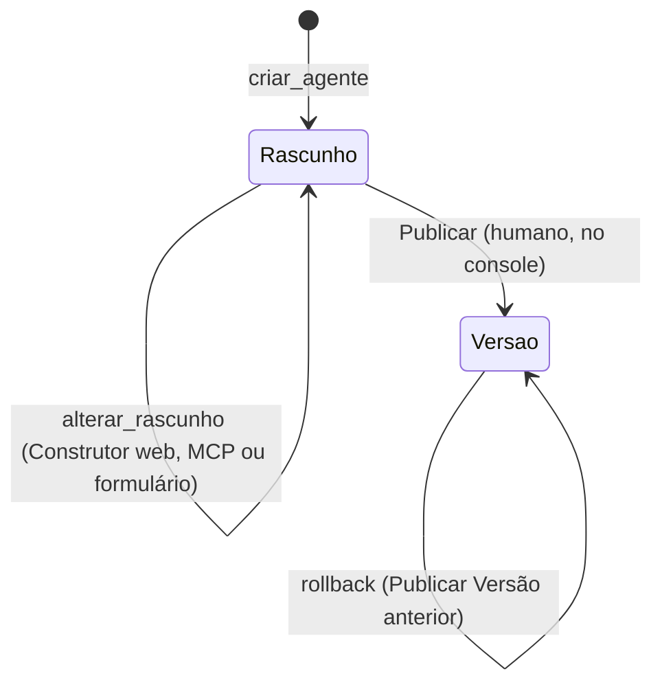

# 03 — Especificação do Agente

A spec é o que o Construtor edita, o que o console mostra em formulário e o que o runtime executa. É um documento JSON validado por Zod, dono: slice `agentes`.

## Ciclo de vida



- O **Rascunho** vale contra a **forma parcial** do schema: todo campo é opcional, mas todo campo presente é válido. Assim o Construtor salva a cada passo sem quebrar nada.
- **Publicar** valida contra o **schema completo** e contra o estado atual da Organização (Conexão de LLM existe e não foi revogada, Integrações existem, ferramentas citadas existem). Passando, cria a Versão `numero + 1` e aponta `agente.versao_publicada_id` para ela.
- Conversas em andamento usam a nova Versão a partir do próximo turno. Cada mensagem do Agente guarda o `versao_id` que a produziu.
- **Rollback** é Publicar uma Versão anterior. **Diff** é calculado na hora entre dois JSONs (Rascunho × publicada, ou Versão × Versão) e mostrado por seção no console.

## Schema v1

```ts
import { z } from "zod";

export const AgentSpecV1 = z.object({
  versaoSchema: z.literal(1),
  identidade: z.object({
    nome: z.string().min(1).max(60),
    persona: z.string().max(2000),
    tomDeVoz: z.string().max(500),
    idioma: z.literal("pt-BR"),
  }),
  instrucoes: z.string().min(1).max(20000),
  objetivos: z.array(z.string().max(300)).max(10),
  restricoes: z.array(z.string().max(300)).max(20),
  conhecimento: z.object({
    usarBrainDaOrganizacao: z.boolean(),
    citarFontes: z.boolean(),
  }),
  integracoes: z
    .array(
      z.object({
        integracaoId: z.uuid(),
        ferramentas: z.array(z.string()).min(1),
      }),
    )
    .max(10),
  modelo: z.object({
    conexaoId: z.uuid(),
    modelo: z.string().min(1),
  }),
  transferencia: z.object({
    quando: z.string().min(1).max(2000),
    mensagemAoContato: z.string().min(1).max(500),
  }),
  limites: z.object({
    tetoPorConversaUsd: z.number().positive().max(10),
    maxChamadasDeFerramentaPorTurno: z.number().int().min(0).max(10),
    maxTokensResposta: z.number().int().min(64).max(2000),
  }),
  mensagens: z.object({
    boasVindas: z.string().max(500).optional(),
    aoAtingirTeto: z.string().min(1).max(500),
    aoFalhar: z.string().min(1).max(500),
    aoReceberAudio: z.string().min(1).max(500),
  }),
});
```

| Campo | Para quê |
|---|---|
| `restricoes` | promessas proibidas definidas pela Organização ("nunca prometa prazo de entrega"); entram no prompt como regras |
| `conhecimento` | Fontes de escopo Agente sempre entram; `usarBrainDaOrganizacao` liga as de escopo Organização |
| `integracoes[].ferramentas` | lista explícita das ferramentas liberadas; uma Integração com 30 ferramentas expõe só as escolhidas |
| `modelo.conexaoId` | referência por id a uma Chave da Organização (slice `llm`); a chave nunca aparece na spec |
| `transferencia.quando` | critérios, em linguagem natural, para o Agente Transferir a Conversa (ex.: "o cliente pede um humano", "reclamação de cobrança", "não encontrou a resposta no Brain duas vezes") |
| `transferencia.mensagemAoContato` | o que o Contato recebe ao ser transferido (ex.: "Vou chamar alguém da equipe, já já te respondem") |
| `limites.tetoPorConversaUsd` | Teto de gasto da Conversa; o da Organização fica no slice `llm` |
| `mensagens.aoReceberAudio` | resposta do Agente a um áudio (ex.: pedir que o Contato escreva); a transcrição é manual, na inbox ([04](04-canais.md)) |

**Evolução do schema.** Cada Versão guarda o `versaoSchema` com que nasceu e nunca é reescrita. Quando surgir a v2, o slice `agentes` ganha uma função `v1 → v2` aplicada na leitura; o runtime sempre recebe a versão mais recente.

## Da spec ao prompt

O runtime compila a spec em blocos, sempre na mesma ordem, para aproveitar o cache de prompt dos provedores (qualquer byte diferente no prefixo invalida o que vem depois):

1. **Ferramentas**, em ordem alfabética: as das Integrações liberadas (`mcp__{integração}__{ferramenta}`, mesmo padrão do `proxy-tool-name.ts` do Craft) e as internas: `buscar_conhecimento` e `transferir_para_operador(motivo)`. A descrição de `transferir_para_operador` inclui o texto de `transferencia.quando`. Ao ser chamada, o runtime envia `transferencia.mensagemAoContato`, a Conversa vai para `aguardando_operador` e o turno termina.
2. **Regras da plataforma**, texto fixo do Dobrai: fronteira de conteúdo não confiável, conduta, formato por Tipo de canal.
3. **A Versão**: identidade, instruções, objetivos e restrições. Ponto de cache aqui; muda só quando alguém Publica.
4. **Histórico da Conversa** e a mensagem nova.

Trechos do Brain e respostas de Integrações entram como resultado de ferramenta, dentro de um bloco `<dados origem="…">` saneado (fechamento de tags neutralizado, mesmo cuidado do `prompts/prompt-sanitize.ts` do Craft). As regras da plataforma dizem que o conteúdo desse bloco é informação, nunca instrução. Mensagens de Contatos entram como turno de usuário e nunca no bloco de sistema.

## Ferramentas do Construtor

Uma lista única serve o Construtor web (ferramentas do loop) e o MCP do Construtor (ferramentas MCP, com o JSON Schema gerado do Zod). O formato segue o `SESSION_TOOL_DEFS` do Craft (`packages/session-tools-core/src/tool-defs.ts`): nome, descrição, entrada Zod, `somenteLeitura` e `executar(ctx, args)`.

| Ferramenta | Faz | Somente leitura |
|---|---|---|
| `listar_organizacoes` | Organizações em que o Membro é Dono ou Admin (no web, a Organização já vem do console) | sim |
| `listar_agentes` | Agentes da Organização, com estado do Rascunho e Versão publicada | sim |
| `criar_agente` | cria Agente e Rascunho vazio | não |
| `ler_rascunho` | spec atual, pendências para Publicar e diff contra a Versão publicada | sim |
| `alterar_rascunho` | aplica operações JSON Patch (RFC 6902) com justificativa; valida a forma parcial; grava `alteracao_rascunho` com a origem | não |
| `listar_recursos` | Conexões de LLM (provedor e modelos, nunca a chave), Integrações e suas ferramentas, Fontes de conhecimento e Canais | sim |
| `adicionar_fonte_url` | cria uma Fonte de conhecimento a partir de uma URL, com escopo Organização ou Agente | não |
| `testar_no_playground` | roda o Rascunho sobre até 10 mensagens de Contato e devolve a transcrição, as ferramentas chamadas e o custo | sim* |
| `comparar_versoes` | diff entre Rascunho e Versões | sim |

\* não altera dados, mas gasta tokens na Chave da Organização (registrado como `origem = playground`).

Três regras moram no invólucro comum de todas as ferramentas, não em cada uma:

- **Papel:** só Dono e Admin da Organização alcançam as ferramentas; Operador recebe erro.
- **Publicar fica fora da lista.** O Construtor termina dizendo ao Membro que o Rascunho está pronto e onde Publicar no console.
- **Segredos ficam fora da conversa.** Chaves de API e credenciais de Integração são digitadas no console, em formulário próprio, e nunca passam pelo modelo.

## Playground

O Playground roda o mesmo `executarTurno` do slice `runtime` que atende Contatos, dentro do processo do plano de controle, com três diferenças: recebe o Rascunho em vez da Versão, simula o Tipo de canal escolhido (widget ou WhatsApp, o que muda o formato da resposta) e não grava Contato nem Conversa. O custo é registrado em `evento_uso` com `origem = playground`.

## Construtor web

Mesmo loop do runtime (`packages/agent-loop`), com as ferramentas acima e o prompt do Construtor versionado no slice `construtor`. Usa uma Chave da Organização escolhida pelo Membro; o custo vai para `evento_uso` com `origem = construtor`. O histórico fica em `mensagem_construtor`.

O MCP do Construtor expõe as mesmas ferramentas e, além delas, as instruções do Construtor no campo `instructions` do servidor e como prompt MCP `construtor`, para que o Claude Code, o Codex ou o Claude.ai trabalhem com o mesmo roteiro.
