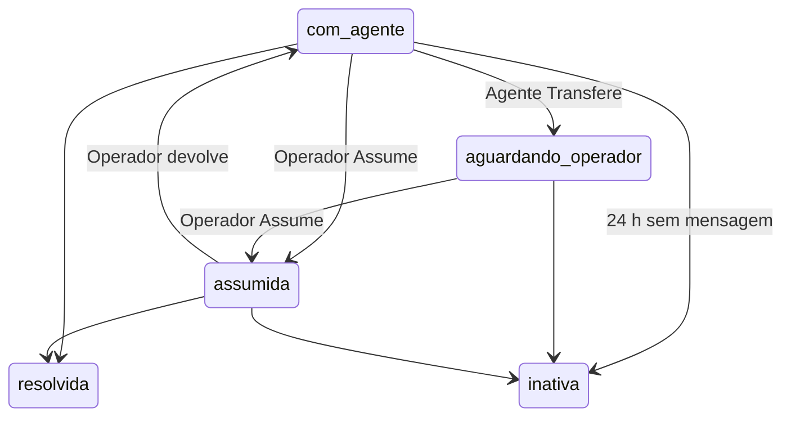
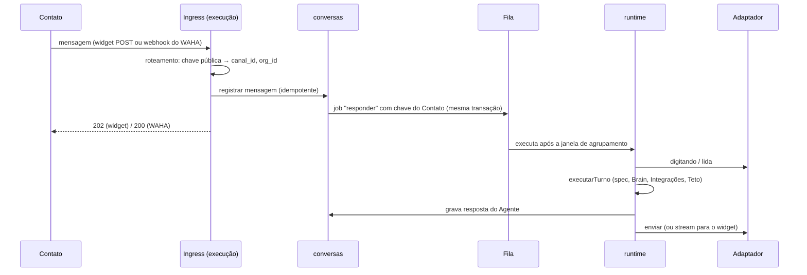

# 04 — Canais

Dono: slice `canais` (adaptadores e configuração do Canal) com o slice `conversas` (Contato, Conversa, mensagens) e o `runtime` (resposta do Agente). No MVP existem dois Tipos de canal: widget e WhatsApp não oficial. O WhatsApp oficial entra como interface prevista.

## Abstração

```ts
type TipoDeCanal = "widget" | "whatsapp_nao_oficial" | "whatsapp_oficial";

type ConteudoNormalizado =
  | { tipo: "texto"; texto: string }
  | { tipo: "midia"; midia: "imagem" | "audio" | "documento" | "video"; ref: string; mime: string; legenda?: string }
  | { tipo: "localizacao"; latitude: number; longitude: number; nome?: string };

type EventoDeCanal =
  | { tipo: "mensagem_recebida"; canalId: string; idExterno: string; remetente: IdentificadorDeContato; conteudo: ConteudoNormalizado; recebidaEm: Date }
  | { tipo: "status_entrega"; canalId: string; idExterno: string; status: "enviada" | "entregue" | "lida" | "falhou" }
  | { tipo: "estado_conexao"; canalId: string; estado: "ativo" | "desconectado" };

interface AdaptadorDeCanal {
  tipo: TipoDeCanal;
  capacidades: {
    streaming: boolean;
    formatacao: "markdown" | "whatsapp";
    janelaDeSessaoHoras?: number;
  };
  normalizar(entrada: unknown): EventoDeCanal[];
  enviar(canal: Canal, destino: IdentificadorDeContato, conteudo: ConteudoNormalizado): Promise<{ idExterno: string }>;
  indicarDigitando?(canal: Canal, destino: IdentificadorDeContato, ligado: boolean): Promise<void>;
  marcarComoLida?(canal: Canal, idExterno: string): Promise<void>;
}
```

| Capacidade | Widget | WhatsApp não oficial | WhatsApp oficial (previsto) |
|---|---|---|---|
| Resposta em streaming | sim (SSE) | não: mensagem inteira | não |
| Formatação | markdown | negrito/itálico do WhatsApp, sem tabelas | idem |
| Janela de sessão | não há | não há | 24 h após a última mensagem do Contato; fora dela, só template aprovado |
| Iniciar conversa | não | não (regra do produto, [ADR-0006](adr/0006-waha-para-whatsapp-nao-oficial.md)) | só com template |

No MVP, o Agente lê e escreve texto. Mídia recebida é guardada e aparece para o Agente como descrição (`[imagem recebida: legenda]`).

**Áudio.** O Agente não transcreve sozinho. Ao receber áudio, ele responde com `mensagens.aoReceberAudio` (por exemplo, pedindo que o Contato escreva) e segue a Conversa. Na inbox, cada áudio tem o botão **Transcrever**, para Operador, Admin ou Dono. O clique transcreve com a Chave da Organização, quando o provedor oferece transcrição (OpenAI ou Google), e grava o texto em `mensagem.transcricao`. O custo entra em `evento_uso` com `origem = transcricao`. Com outros provedores, o botão aparece desabilitado com a explicação.

## Transferir para Operador



- **Quem decide é o Agente.** A ferramenta interna `transferir_para_operador(motivo)` fica sempre disponível. Os critérios vêm de `transferencia.quando`, na spec ([03](03-agent-spec.md)). O Construtor ajuda o Membro a escrever esses critérios.
- **Ao Transferir**, o runtime envia `transferencia.mensagemAoContato`, grava o motivo, muda a Conversa para `aguardando_operador` e emite `conversa.transferida`. O console dos Operadores recebe o aviso em tempo real (SSE) e mostra a fila de Conversas aguardando, da mais antiga para a mais nova.
- **Fora de `com_agente` o Agente fica calado.** O job `responder` confere o estado e termina sem chamar o modelo. As mensagens do Contato continuam chegando na inbox.
- **Sem Operador disponível**, a Conversa espera. A mensagem ao Contato não promete prazo. Horário de atendimento e aviso fora do expediente ficam para a F3.

## Entrada



- **Nada é processado dentro da requisição.** O ingress valida, grava e enfileira; responde em milissegundos. Webhook lento faz o WAHA reenviar, e o reenvio cai na idempotência.
- **Idempotência.** `unique (canal_id, id_externo)` em `conversas.mensagem`. No widget, `id_externo` é um UUID gerado no navegador por mensagem; no WAHA, o id da mensagem do WhatsApp. Um conflito na inserção encerra o processamento sem erro.
- **Enfileirar na mesma transação.** A fila vive no mesmo Postgres, então gravar a mensagem e criar o job são atômicos. Não há mensagem gravada sem job nem job sem mensagem.

## Ordem e agrupamento

Contatos no WhatsApp mandam várias mensagens curtas em sequência ("oi", "tudo bem?", "queria saber do horário"). Responder a cada uma gera três respostas desencontradas.

- **Um job pendente por Conversa.** O job `responder` usa a Conversa como chave. Mensagem nova com job ainda pendente reagenda o mesmo job para `agora + janela` em vez de criar outro.
- **Janela de agrupamento** de 3 s por padrão (configurável por Canal; o widget usa 0, porque o visitante espera ver a resposta começar).
- **Execução serial por Contato.** Jobs do mesmo Contato rodam um de cada vez, em ordem; Contatos diferentes rodam em paralelo.
- **O turno consome tudo o que chegou.** Ao executar, o runtime lê todas as mensagens do Contato ainda sem resposta e responde uma vez.

O mecanismo da fila que entrega essas três propriedades está em [05](05-slices-e-deploy.md).

## Saída

- **Widget:** o runtime publica os deltas de texto no canal `NOTIFY conversa_<id>` do Postgres; o ingress, que segura a conexão SSE do visitante, repassa. Os tipos de evento seguem o `AgentEvent` do Craft (`packages/core/src/types/message.ts`): `texto_delta`, `texto_completo`, `ferramenta_inicio`, `ferramenta_fim`, `erro`, `concluido`.
- **WhatsApp:** marca como lida, liga "digitando", gera a resposta inteira e envia. Resposta longa sai em até três mensagens, quebradas por parágrafo.
- **Operador:** a mensagem digitada na inbox passa por `conversas` e sai pelo mesmo `enviar` do adaptador.
- **Status de entrega:** eventos de confirmação do WAHA viram `status_entrega` em `conversas.mensagem`.
- **Falha no envio:** o job tenta de novo com backoff; esgotadas as tentativas, vai para a fila de falhas e a mensagem fica `falhou`, visível na inbox.

## Widget

- **Instalação:** `<script src="https://chat.dobrai.ai/widget.js" data-canal="pub_…" async>`. O script é servido pelo plano de execução, atrás do CDN gratuito do Cloudflare.
- **Domínios permitidos:** o ingress confere o `Origin` contra a lista do Canal e recusa os demais.
- **Visitante:** id aleatório guardado no `localStorage`, trocado na primeira mensagem por um token assinado de curta duração, que autentica a conexão SSE. Esse id é o identificador do Contato (`tipo_identificador = visitante`).
- **Abuso:** limite de mensagens por visitante e por IP no ingress; o Teto de gasto segura o custo se o limite falhar.
- **Aparência:** cor, nome exibido, avatar, posição e mensagem de boas-vindas, no `config` do Canal.

## WhatsApp não oficial (WAHA)

- **Conectar:** o Admin cria o Canal no console, lê e aceita o aviso de risco de bloqueio, e o console mostra o QR code da sessão do WAHA. A sessão se chama pela chave pública do Canal, registrada em `canais.roteamento`.
- **Webhook:** o WAHA chama o `execucao` pela rede interna do Docker, sem passar pela internet, e assina cada requisição com HMAC sha512; o ingress confere a assinatura antes de qualquer outra coisa. Referência dos eventos: [WAHA events](https://waha.devlike.pro/docs/how-to/events/).

  | Evento do WAHA | Vira | Idempotência |
  |---|---|---|
  | `message` | `mensagem_recebida` | id da mensagem (`{fromMe}_{chatId}_{messageId}`) em `unique (canal_id, id_externo)` |
  | `message.ack` | `status_entrega` (1 = enviada, 2 = entregue, 3 = lida, -1 = falhou) | o status só avança; ack repetido ou atrasado não regride |
  | `session.status` | `estado_conexao` | `WORKING` = ativo; `SCAN_QR_CODE`, `PASSKEY_REQUIRED` e `FAILED` = desconectado, com o motivo mostrado ao Admin |

- **Mídia recebida** vai para o Cloudflare R2 pelo armazenamento S3 do próprio WAHA (`WAHA_MEDIA_STORAGE=S3`); a mensagem guarda a referência.
- **Só responder:** o adaptador não expõe envio para quem nunca escreveu. O Operador também só responde Conversas existentes.
- **Desconexão:** Canal `desconectado` gera alerta na inbox e para o processamento de saída; os jobs esperam com backoff até a reconexão.
- **Mitigação de bloqueio:** a sequência que o WAHA recomenda ([how to avoid blocking](https://waha.devlike.pro/docs/overview/how-to-avoid-blocking/)): `sendSeen`, `startTyping`, espera proporcional ao tamanho da resposta com variação aleatória, `stopTyping`, envio. Nenhuma mensagem em massa; erros 463 e 475 (limites para contatos frios) geram alerta. A taxa de bloqueio é medida no staging antes do primeiro cliente ([07](07-riscos.md)).

## WhatsApp oficial (previsto)

O CNPJ já existe, então o processo de Tech Provider (Business Verification, App Review, Access Verification) pode começar agora. O adaptador entra no roadmap assim que a Meta aprovar (F2.10 em [06](06-roadmap.md)). O que a abstração já prevê: `janelaDeSessaoHoras = 24`, envio de template fora da janela e status por mensagem. A Meta cobra cada Organização direto no cartão dela, sem passar pelo Dobrai.

Preços da Meta para o Brasil, por mensagem entregue ([tabela oficial](https://developers.facebook.com/documentation/business-messaging/whatsapp/pricing), vigente desde 01/07/2026, consultada em 28/09/2026):

| Categoria | US$ | R$ |
|---|---|---|
| Marketing | 0,0625 | 0,3217 |
| Utilidade | 0,0068 | 0,0350 |
| Autenticação | 0,0068 | 0,0350 |
| Atendimento (resposta dentro da janela) | grátis até 30/09/2026 | grátis até 30/09/2026 |

A partir de 01/10/2026, a mensagem de atendimento passa a custar o mesmo que a de utilidade, com 1.000 gratuitas por número por mês. Templates de utilidade dentro da janela também passam a ser cobrados. Uma Organização com ~2.000 respostas por mês pagaria ~US$ 7 à Meta [I].
