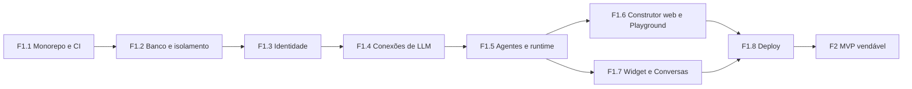

# 06 — Roadmap

Cada entrega é pequena o bastante para uma sessão de trabalho e termina num critério verificável: um teste que passa ou uma demonstração com resultado observável. A ordem segue as dependências.

## F1 — walking skeleton

| # | Entrega | Critério de aceite |
|---|---|---|
| F1.1 | Monorepo (Bun workspaces, TypeScript estrito), slices como pacotes com `exports` restritos à API de módulo, CI no GitHub Actions | `bun run ci` verde no GitHub; importar um arquivo interno de outro slice quebra o typecheck |
| F1.2 | Postgres com um schema e um papel por slice, migrações por slice, `app.org_atual()`, helper de teste de isolamento | o teste de isolamento de um slice de exemplo fica vermelho quando a política de RLS é removida |
| F1.3 | `identidade`: Better Auth, cadastro cria Organização com o Usuário como Dono, convite com Papel | Membro de duas Organizações alterna entre elas e só vê dados da ativa (teste de ponta a ponta) |
| F1.4 | `llm`: Chave da Organização cifrada, teste da chave, `evento_uso`, `consumo`, tabela de preços | a chave nunca aparece em resposta de API nem em log (teste que procura a chave nas saídas); custo de uma chamada bate com a tabela |
| F1.5 | `agentes` (Rascunho, Versão, Publicar e rollback no console) e `runtime` (`executarTurno` sem Integrações) sobre `packages/agent-loop` | Publicar com spec incompleta mostra as pendências; rollback volta a responder com a Versão anterior |
| F1.6 | `construtor` web e Playground | um Membro descreve um Agente em linguagem natural e sai com um Rascunho que passa na validação de Publicar; o Playground responde com o Rascunho |
| F1.7 | `canais` (widget), `conversas`, fila por Contato, SSE | numa página de teste, o Contato recebe a resposta em streaming; reenviar a mesma mensagem (mesmo id do cliente) não gera segunda resposta |
| F1.8 | Kamal para controle e execução, staging na Oracle, produção na Contabo, backup no R2 | rollback do controle não derruba uma Conversa em andamento no widget; restauração do backup testada |

A F1 está pronta quando o custo da Conversa aparece no console, controle e execução têm deploy e rollback independentes, e o teste de isolamento de todos os slices passa no CI.

## F2 — MVP vendável

| # | Entrega | Critério de aceite |
|---|---|---|
| F2.1 | MCP do Construtor (plugin `mcp` do Better Auth) | Claude Code conectado ao MCP cria um Agente, altera o Rascunho e roda o Playground; não existe ferramenta de Publicar |
| F2.2 | WhatsApp não oficial via WAHA: conexão por QR no console com aviso de risco, entrada e saída, "digitando" e lido, agrupamento de mensagens | três mensagens seguidas do Contato geram uma resposta só; reiniciar o contêiner do WAHA restaura a sessão sem novo QR |
| F2.3 | Inbox mínima: ver, Assumir, devolver, em tempo real; Agente Transfere sozinho (`transferir_para_operador`); botão Transcrever em áudios | no Playground, um Contato que pede "quero falar com uma pessoa" é Transferido e recebe `transferencia.mensagemAoContato`; a Conversa aparece como aguardando no console; depois de Assumir, o Agente não responde e a resposta do Operador chega ao WhatsApp; um áudio transcrito mostra o texto e o custo |
| F2.4 | Brain: arquivo (PDF, DOCX, TXT), URL e sitemap; busca híbrida com citações | pergunta cuja resposta está num PDF volta com a citação certa; o teste de isolamento cobre a busca vetorial |
| F2.5 | Teto de gasto por Organização e por Conversa | com o teto atingido, o Contato recebe `mensagens.aoAtingirTeto` e nenhuma chamada nova vai ao provedor |
| F2.6 | Integração por MCP remoto via URL, com lista de ferramentas liberadas por Agente | o Agente chama uma ferramenta liberada e não enxerga as outras |
| F2.7 | Excluir Contato | depois da exclusão, nenhuma tabela de nenhum slice guarda dado do Contato (teste que consulta todos os schemas) e a conversa some do WAHA |
| F2.8 | Operação: Sentry, alertas de disco, RAM acima de 75% e falha de backup | um alerta de teste chega ao canal de avisos |
| F2.9 | Termos de uso e DPA revisados por advogado (fora do código) | documentos publicados antes do primeiro cliente pagante |
| F2.10 | WhatsApp oficial (Cloud API com Embedded Signup), só depois de a Meta aprovar o Tech Provider | uma Organização conecta o número pelo Embedded Signup e o Agente responde dentro da janela de 24 h |

**Começa já, fora do código:** Business Verification da empresa na Meta e o processo de Tech Provider (App Review e Access Verification), que correm em paralelo à F1 e liberam a F2.10.

## F3 em diante

- Horário de atendimento e aviso fora do expediente
- Transcrição automática de áudio, para o Agente entender sem clique humano
- Casos de teste salvos e evals por Versão
- Guardrails avançados: redação de PII, detecção de jailbreak
- Memória do Contato
- Billing e gateway próprio de LLM
- Analytics além de contadores
- Push no PWA
- Desktop (fork do Craft em repositório separado)
- Skills, catálogo de Integrações, OAuth para MCPs de terceiros
- SSO, trilha de auditoria, white-label, notas e etiquetas na inbox
